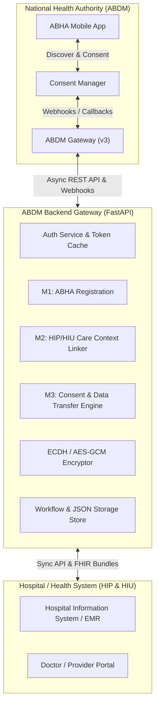

<div align="center">

# 🏥 ABDM Backend APIs & Interoperability Gateway

**Production-grade, developer-friendly, and lightweight FastAPI implementation of the Ayushman Bharat Digital Mission (ABDM) Milestone 1, 2, and 3 specifications.**

[](https://www.python.org/downloads/)
[](https://fastapi.tiangolo.com)
[](https://abdm.gov.in)
[](https://hl7.org/fhir/R4/)
[](https://www.docker.com/)
[](LICENSE)
[](CONTRIBUTING.md)

[Features](#-key-features) • [Architecture](#-architecture) • [Quickstart](#-quickstart-in-60-seconds) • [API Reference](#-api-endpoints-summary) • [Contributing](#-contributing) • [Roadmap](#-roadmap)

</div>

---

## 📌 Overview

Integrating with the **National Health Authority (NHA) Ayushman Bharat Digital Mission (ABDM)** ecosystem can be challenging due to asynchronous bi-directional webhooks, multi-step JWT signature handshakes, strict header criteria, and complex FHIR R4 schema formatting.

**ABDM Backend APIs** provides an out-of-the-box, certified, plug-and-play solution for **Health Information Providers (HIP)** and **Health Information Users (HIU)** to connect with the ABDM Gateway seamlessly.

### 💡 Why Use This?
- ⚡ **Zero-Database Hassle**: Runs out-of-the-box with high-performance in-memory and thread-safe JSON persistence—no mandatory PostgreSQL or MongoDB setup needed for certification.
- 🔄 **Self-Healing Handshakes**: Automated upstream gateway token generation, certificate discovery, and automatic callback acknowledgements (< 300ms).
- 🔐 **End-to-End Encryption**: Compliant Diffie-Hellman (ECDH) key exchange with AES-GCM decryption/encryption for clinical record transfers.
- 📦 **Docker-Native**: Ready to deploy locally or to cloud environments in seconds via Docker Compose.

---

## 🚀 Key Features

### 🏛️ Milestone 1 (M1): ABHA Enrollment & Verification
- ABHA V3 creation via Mobile OTP & Aadhaar OTP.
- ABHA address search, verification, and demographics validation.
- Public key certificate discovery and caching from central registry.

### 🔗 Milestone 2 (M2): Care Context Linking & Discovery
- **HIP-Initiated Linking**: Automated link token generation (`/v3/token/generate-token`) and care context linking (`/v3/link/carecontext`).
- **Patient-Initiated Linking**: Asynchronous discovery webhook (`/patient/care-context/discover`), dynamic OTP generation, SMS delivery, and link confirmation.
- **Scan & Share**: Counter QR code generation and patient profile share webhooks.

### 📋 Milestone 3 (M3): Consent Management & FHIR Data Flow
- **HIU Consent Initiation**: Create and send consent requests (`/consent/requests/init`) with dynamic date ranges and configurable HI types.
- **Consent Callbacks**: Asynchronous receipt and management of consent notifications (`/v3/consent/request/hip/notify`).
- **FHIR R4 Data Transfer**: End-to-end encrypted transfer of Prescriptions, Diagnostic Reports, OP Consultations, and Discharge Summaries.

---

## 🏗️ Architecture



---

## ⚡ Quickstart in 60 Seconds

### Option A: Using Docker (Recommended)

```bash
# 1. Clone the repository
git clone https://github.com/Hey-Dhruv-15/ABDM-BE-APIS.git
cd ABDM-BE-APIS

# 2. Configure environment variables
cp .env.example .env

# 3. Start the gateway and services
docker compose up -d

# 4. Check health
curl http://localhost:8005/health
```

### Option B: Local Python Setup

```bash
# 1. Create and activate a virtual environment
python -m venv .venv
source .venv/bin/activate  # On Windows: .venv\Scripts\activate

# 2. Install dependencies
pip install -r requirements.txt

# 3. Start development server
uvicorn app.main:app --host 0.0.0.0 --port 8000 --reload
```

Interactive Swagger documentation is available at **`http://localhost:8000/docs`**!

---

## 📖 API Endpoints Summary

| Method | Endpoint | Description | Milestone |
|---|---|---|---|
| `POST` | `/api/v1/hiecm/gateway/v3/sessions` | Fetch / refresh ABDM Gateway session bearer token | Common |
| `PATCH` | `/api/v1/hiecm/gateway/v3/bridge/url` | Register or update Bridge public callback URL | M1 / M2 |
| `POST` | `/api/v1/hiecm/v3/token/generate-token` | Generate link token for HIP-initiated linking | M2 |
| `POST` | `/api/v1/hiecm/hip/v3/link/carecontext` | Link patient care context using genuine link token | M2 |
| `POST` | `/api/v1/v3/hip/patient/care-context/discover` | Patient discovery webhook from ABHA app | M2 |
| `POST` | `/api/v1/links/link/init` | User-initiated OTP verification initiation | M2 |
| `POST` | `/api/v1/links/link/confirm` | Confirm user OTP and link health records | M2 |
| `POST` | `/api/v1/consent/requests/init` | Initiate HIU consent request to patient | M3 |
| `POST` | `/api/v1/v3/consent/request/hip/notify` | Handle consent approval/denial notification | M3 |
| `POST` | `/api/v1/v3/hip/health-information/request` | Dispatch encrypted FHIR health information bundle | M3 |
| `GET` | `/api/v1/consent-requests` | View all active consent requests & status | UI / Dashboard |

---

## 🧪 Testing & Verification

The repository comes with a comprehensive test suite testing ABDM V3 contracts and edge cases:

```bash
# Run all test suites
pytest

# Test Milestone 2 (Discovery, Linking, Bridge services)
pytest tests/test_abdm_m2.py

# Test Milestone 3 (HIU Mandatory consent flows)
pytest tests/test_abdm_hiu_m3_mandatory.py
```

---

## 🗺️ Roadmap

- [x] **Milestone 1**: ABHA creation, verification, public key discovery.
- [x] **Milestone 2**: HIP-initiated linking, user-initiated discovery & dynamic OTP, Scan & Share.
- [x] **Milestone 3**: Consent management, notification handlers, encrypted FHIR data transfer.
- [ ] **ABHA 2.0**: Enhanced unified ABHA profile endpoints and biometric auth.
- [ ] **HL7-v2 to FHIR Converter**: Native pipeline to transform legacy HL7 v2.x feeds into compliant FHIR R4 bundles.
- [ ] **Multi-Facility HSP Manager**: Support multiple registered clinics under a single gateway instance.

---

## 🤝 Contributing

Contributions are what make the open-source community such an amazing place to learn, inspire, and create. Any contributions you make are **greatly appreciated**.

Please check out our [Contributing Guidelines](CONTRIBUTING.md) to get started!

---

## 📄 License

Distributed under the **MIT License**. See [`LICENSE`](LICENSE) for more information.

---

<div align="center">
  <b>Built with ❤️ for Indian Healthcare & the ABDM Open Source Community</b>
</div>
